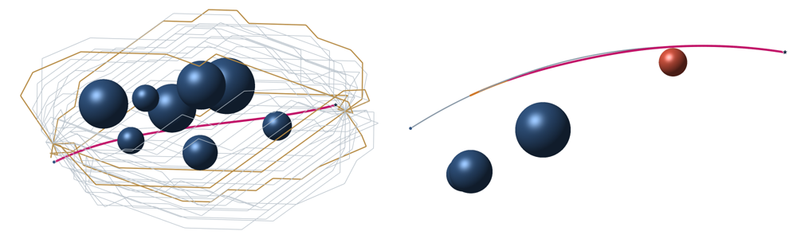

# Flexible needle trajectory planning and online replanning

MATLAB implementation accompanying *Computational optimal control for flexible needle trajectory planning and online replanning*, by Bai Li, Yakun Ouyang, Zhuyan Yin, Xinwei Wang, and Yongxiao Tian, for the *Journal of Computational Design and Engineering*.

[Annotated animations on Bilibili](https://www.bilibili.com/video/BV1sfxzziEbz/) · [Example insertion video (MP4)](videos/1.mp4) · [Twenty benchmark geometries](Cases.mat)



*Left: geometric routes and the selected trajectory in benchmark case 8. Right: the accepted remaining trajectory after an obstacle moves into the original path. Pink denotes the selected or replanned trajectory.*

## Plan an insertion

Open MATLAB in the repository root. The examples were tested with MATLAB R2021b and CasADi 3.6.1. The supplied configuration uses IPOPT with the HSL MA97 linear solver; MA97 must be available to IPOPT. Set `CASADI_ROOT` to the directory that contains `+casadi` if the CasADi MATLAB interface is not already on the path.

```matlab
setenv('CASADI_ROOT', 'C:/casadi')
[result, figures] = RunMe(8, false);
```

[RunMe.m](RunMe.m) accepts a case number from 1 to 20. The planner generates spatial routes with A*, selects geometrically distinct representatives, and uses them to initialize numerical optimal control solves. The motion cost penalizes insertion time, control effort, and changes in the controls, with an elevation-margin regularizer. Accepted trajectories are compared using an additional obstacle-proximity score evaluated on the physical geometry.

The output includes the selected three-dimensional trajectory and nine traces: position, azimuth, elevation, axial roll, speed, acceleration, and axial rotation rate. Results are saved under `results/`. To animate an accepted solution that has already been saved, run `MakeVideo(8)`. The MP4 in `videos/8.mp4` follows the needle tip and displays its rotating local coordinate frame.

## Replan after a single event

```matlab
[output, figures] = RunOnlineReplanner();
```

[RunOnlineReplanner.m](RunOnlineReplanner.m) generates a new scene, solves its offline problem, and builds a library of candidate sensitivity anchors. It then samples one event on the nominal trajectory. For a reproducible scene and event type, use an explicit seed:

```matlab
[output, figures] = RunOnlineReplanner(260928, 'obstacle');
```

| Event | What changes |
| --- | --- |
| `'position'` | The measured insertion depth shifts along the local trajectory tangent. |
| `'orientation'` | The measured needle tip has an axial-roll deviation. |
| `'obstacle'` | A sphere moves into the planned remaining path. |

For a state deviation, the planner queries the nearest anchor and tests whether its sensitivity prediction can be used. A correction is returned only after checking the trajectory constraints, the replayed motion, and nonlocal needle-body separation. If replanning requires a stop, the remaining problem starts from the measured stopped state. An obstacle change first triggers a check of the reference path; an intrusion calls for a stopped-state solve with the updated geometry.

The online demo writes static figures, the nominal solution, the sensitivity library, and the event response to a new folder under `results/`. The random scene and the 201-anchor setting belong to this demonstration. The article gives the configurations and fixed events used for its reported timing comparisons.
