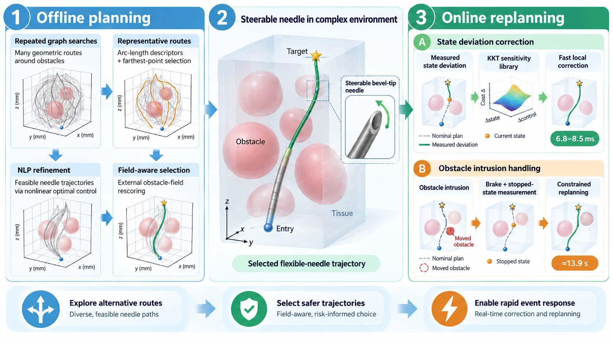
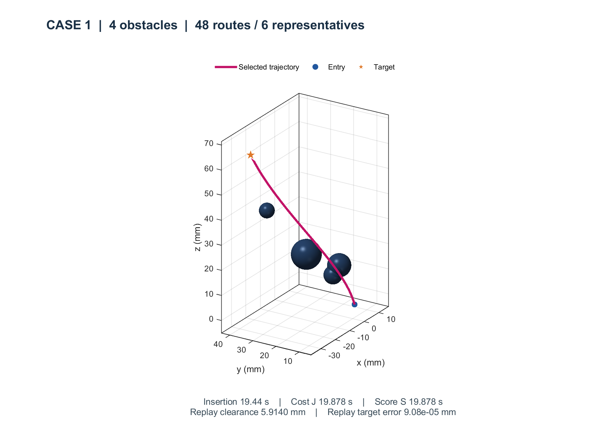
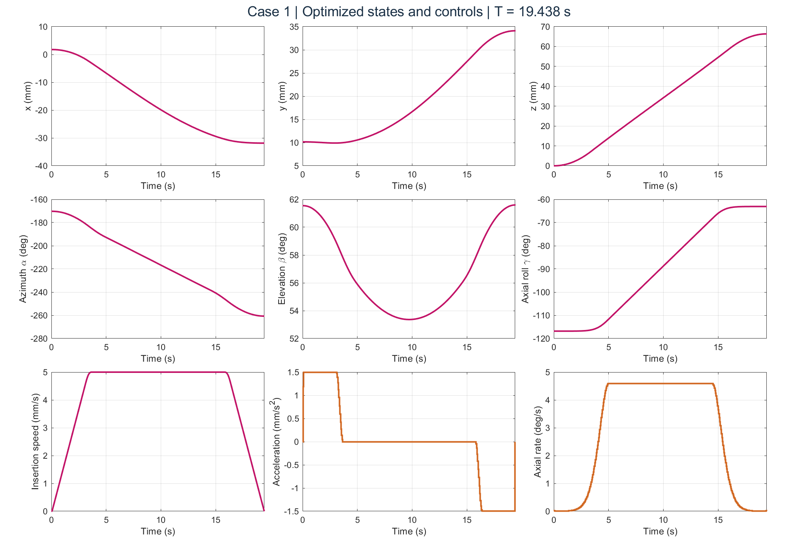
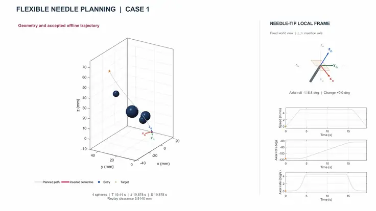
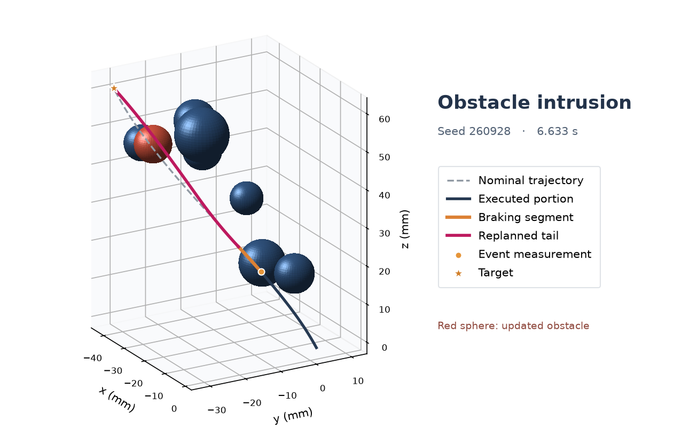

# Flexible needle trajectory planning and online replanning

[Download ZIP](https://github.com/libai1943/Needle/archive/refs/heads/main.zip) · [Run a benchmark](#plan-an-insertion) · [Replan after an event](#replan-after-one-event) · [Watch the annotated animations](https://www.bilibili.com/video/BV1sfxzziEbz/)

A bevel-tip needle steers by advancing and rotating about its shaft. A short spatial path around an obstacle is useful only if the needle can follow it and reach the target with admissible controls. This MATLAB implementation uses the time available before insertion to explore several routes and fit a needle motion to each. During insertion, it reuses the selected trajectory to correct a measured tip deviation or to plan a new remaining path after an obstacle moves.



**Companion paper** · Bai Li, Yakun Ouyang, Zhuyan Yin, Xinwei Wang, and Yongxiao Tian. *Computational optimal control for flexible needle trajectory planning and online replanning*. Journal of Computational Design and Engineering.

## Plan an insertion

Download and extract the repository, then open its root directory in MATLAB. The examples were tested with **MATLAB R2021b** and the **CasADi 3.6.1 MATLAB interface**, using IPOPT with the **HSL MA97** linear solver. If CasADi is already on your MATLAB path, start at the second line. Otherwise, set `CASADI_ROOT` to the directory containing `+casadi`.

```matlab
setenv('CASADI_ROOT', 'C:/casadi')
[result, figures] = RunMe(1, false);
```

Case 1 has four spherical obstacles. The first figure shows the insertion entry, target, and selected centerline. The second traces the three position components, azimuth, elevation, axial roll, insertion speed, acceleration, and axial rotation rate. The bottom-right panel shows the rotation command, which can be compared directly with the axial-roll trace above it.

<p align="center">
  <a href="results/1_trajectory.png"></a>
  <a href="results/1_variables.png"></a>
</p>

In a run of this command, insertion took **19.438 s** along the planned motion. The motion cost and selection score were both **19.878 s**, and the lower clearance estimate from kinematic replay was **5.914 mm**. MATLAB reports the wall time spent finding the plan separately. The numerical result is saved as `results/1.mat`; each figure is saved as both a PNG and an editable MATLAB FIG.

To see how the needle turns, run `MakeVideo(1)` after solving case 1. The left panel follows insertion as the camera rotates. The right panel isolates the needle-tip coordinate frame, so axial roll remains visible even when viewed along the path. Set the second argument of `RunMe` to `true` to solve and render in one call.

[](videos/1.mp4)

[Full-resolution case 1 video (1080p MP4)](videos/1.mp4)

## Explore the twenty benchmarks

[Cases.mat](Cases.mat) contains the entry, target, obstacle geometry, and model parameters for each fixed case. Pass the case number directly to [RunMe.m](RunMe.m).

| Case numbers | 1–4 | 5–8 | 9–12 | 13–16 | 17–20 |
| --- | ---: | ---: | ---: | ---: | ---: |
| Spheres per case | 4 | 8 | 12 | 18 | 24 |

| Planning step | What happens in the code |
| --- | --- |
| Generate routes | [FindRoutes.m](FindRoutes.m) searches a 5 mm grid up to 48 times, increasing the cost of revisited cells. It samples each route at 40 arc-length locations and selects up to six geometrically distinct representatives for refinement. |
| Fit and refine | [OfflinePlan.m](OfflinePlan.m) fits the routes to the needle model and includes direct, single-route, and LIOM initializations. [BuildNLP.m](BuildNLP.m) forms a 400-node nonlinear program. Its motion cost combines insertion time, control effort, control variation, and an elevation-margin term. |
| Check a candidate | [CheckTrajectory.m](CheckTrajectory.m) checks the discrete constraints, segment-to-sphere clearance, fourth-order Runge–Kutta replay, and separation of nonlocal body segments. A clearance failure can trigger another solve with enlarged planning radii on the same mesh. |
| Select the trajectory | [RiskField.m](RiskField.m) integrates proximity to the physical obstacles along each accepted path. The planner adds the weighted proximity penalty to the motion cost and returns the candidate with the lowest combined score. |

**Case 20 shows why the two selection rules matter.** In the paper's comparison, selecting by the combined score reduced integrated obstacle proximity from 36.296 to 15.423 mm while increasing motion cost from 19.820 to 20.143 s. To inspect the two trajectories from your own run, compare the two rows below. The columns give motion cost (s), integrated proximity (mm), and selection score (s), respectively.

```matlab
r = RunMe(20, false);
byCost = r.min_cost;
byScore = r.best;
[byCost.cost,  byCost.risk.integral_mm,  byCost.selection_score
 byScore.cost, byScore.risk.integral_mm, byScore.selection_score]
```

## Replan after one event

[RunOnlineReplanner.m](RunOnlineReplanner.m) generates a new scene, solves its offline plan, and prepares a sensitivity library before applying **one** sudden event. The entry point samples the geometry, event time, and disturbance from a seed. The target remains fixed and the executed portion of the insertion is retained.

```matlab
[out, figures] = RunOnlineReplanner(260928);
out.event.kind
out.reply.action
out.folder
```

This seed produced an eight-sphere scene. At **6.633 s** a sphere moved into the remaining path. The response was `stopped-state trajectory accepted`. The plot shows the previously planned path, the executed portion, the braking segment, and the new path from the stopped state to the original target.

<p align="center">
  <a href="media/obstacle-replanning.png"></a>
</p>

Call `RunOnlineReplanner()` for a new random scene and event. To choose the event type explicitly, pass a seed and one of the following strings, for example `RunOnlineReplanner(260928, 'orientation')`.

| Mode | Change at the event |
| --- | --- |
| `'position'` | Shift the measured tip position by 0.05–0.20 mm along the local tangent, in either direction. |
| `'orientation'` | Perturb the measured axial roll by 0.01–0.05° in either direction. |
| `'obstacle'` | Move a sphere into the future portion of the nominal trajectory. |

The demonstration prepares 201 candidate anchors along the nominal trajectory. [ReplanLibrary.m](Replan/ReplanLibrary.m) solves the remaining-horizon problems, and [ReplanSensitivity.m](Replan/ReplanSensitivity.m) checks which active-set Karush–Kuhn–Tucker systems can supply a local prediction. The console reports how many anchors are eligible. Library preparation takes place before the event. The paper uses a separate fixed protocol for its event timing measurements.

For a measured state deviation, [ReplanPredict.m](Replan/ReplanPredict.m) uses the nearest anchor and its stored factors to correct the remaining motion. If the corrected trajectory passes validation, it can be returned immediately. When braking is required, [ReplanEvent.m](Replan/ReplanEvent.m) obtains a stopped state and starts the constrained solve there. Inspect `out.reply.action` and `out.reply.result.success` to see which path the code took and whether it returned a trajectory.

## Inspect a run

| Output | Where to look |
| --- | --- |
| Offline candidates | `result.candidates` contains solver status, motion costs, and available acceptance diagnostics. If every candidate fails, the driver saves the result in `results/<case_id>.mat` before raising `NeedleOffline:NoAcceptedPlan`. |
| Position and controls | The nine columns of `reshape(result.best.z(2:end), result.d.n, 9)` are position (x, y, z), speed, acceleration, axial rate, azimuth, elevation, and axial roll. [PlotSolution.m](PlotSolution.m) converts the internal units for display. |
| Single-event output | The directory printed in `out.folder` contains `offline.mat`, `sensitivity_library.mat`, `online.mat`, and the trajectory and state/control plots in PNG and FIG formats. `out.eligible_count` and `out.anchor_count` report library coverage for that scene. |

If MATLAB reports `NeedleOffline:Dependency`, check that `fullfile(getenv('CASADI_ROOT'), '+casadi', 'SX.m')` exists. If CasADi loads but IPOPT cannot initialize MA97, check that your IPOPT installation has access to the HSL solver. The code requests MA97 explicitly in both entry points.
